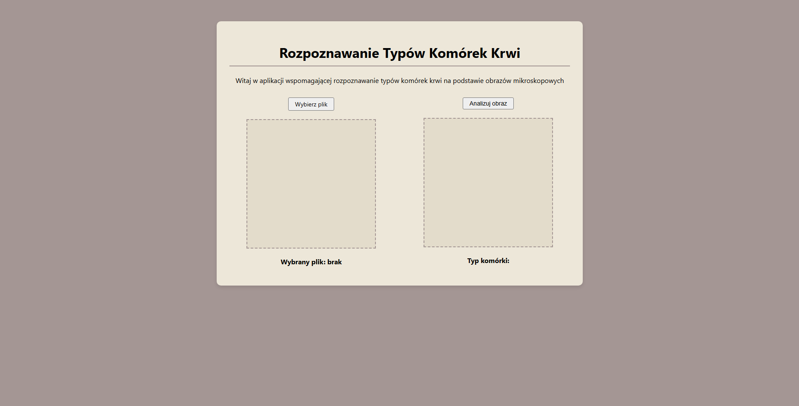

# Aplikacja wspomagająca rozpoznawanie typów komórek krwi na podstawie obrazów mikroskopowych

Projekt realizowany w ramach pracy inżynierskiej. Aplikacja internetowa ma docelowo stanowić narzędzie wspomagające diagnostykę medyczną, umożliwiając zautomatyzowaną klasyfikację białych krwinek z wykorzystaniem modeli uczenia maszynowego.

* **Autor:** Rafał Kruszewski
* **Nr indeksu:** 198259
* **Uczelnia:** Politechnika Gdańska
* **Kierunek:** Inżynieria Biomedyczna
* **Specjalność:** Informatyka w Medycynie

---

## Obecny stan projektu

Obecnie aplikacja posiada w pełni działający interfejs użytkownika (GUI) zaimplementowany przy użyciu frameworka Flask. Poniżej znajduje się zrzut ekranu prezentujący aktualny wygląd strony:



### Zrealizowane funkcjonalności:
* **Przesyłanie plików:** Możliwość wyboru pliku ze zdjęciem mikroskopowym z dysku lokalnego (przycisk *Wybierz plik*).
* **Podgląd na żywo:** Załadowane zdjęcie jest natychmiast wyświetlane w lewym panelu wraz z nazwą pliku.
* **Szablon dla silnika AI:** Przygotowano przycisk *Analizuj obraz*, który obecnie przesyła żądanie do serwera, ale czeka na podpięcie modelu klasyfikującego.
* **Sekcja wyników:** Prawy panel jest przygotowany do wyświetlenia obrazu po przetworzeniu oraz docelowej predykcji (w miejscu *Typ komórki:*).

---

## Technologie
* **Backend:** Python 3, Flask
* **Frontend:** HTML5, CSS3, Vanilla JavaScript

---

## Struktura projektu

```text
├── src/                     # Główny folder z kodem źródłowym aplikacji
│   ├── static/              # Pliki statyczne
│   │   ├── uploads/         # Folder na przesłane przez użytkownika zdjęcia
│   │   ├── script.js        # Logika podglądu zdjęć w JavaScript
│   │   └── style.css        # Style wizualne CSS
│   ├── templates/           # Szablony widoków aplikacji
│   │   └── index.html       # Główny interfejs użytkownika w HTML
│   ├── .gitattributes       # Konfiguracja statystyk języków dla platformy GitHub
│   ├── app.py               # Główny plik uruchomieniowy serwera (Flask)
│   └── model.py             # Miejsce przygotowane na implementację logiki sztucznej inteligencji
├── thesis/                  # Pliki robocze i dokumenty związane z pisaniem pracy inżynierskiej
│   └── INŻYNIERKA.pdf  # Robocza wersja dokumentu pracy
├── interfejs.png            # Zrzut ekranu wykorzystany w dokumentacji
├── README.md                # Dokumentacja projektu 
└── requirements.txt         # Lista wymaganych bibliotek języka Python