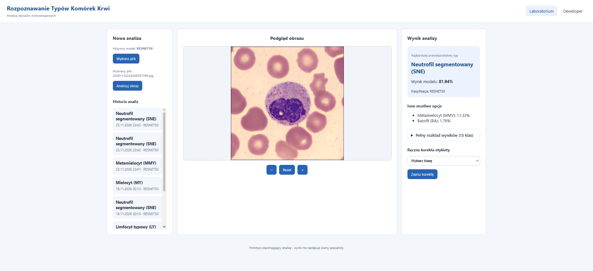
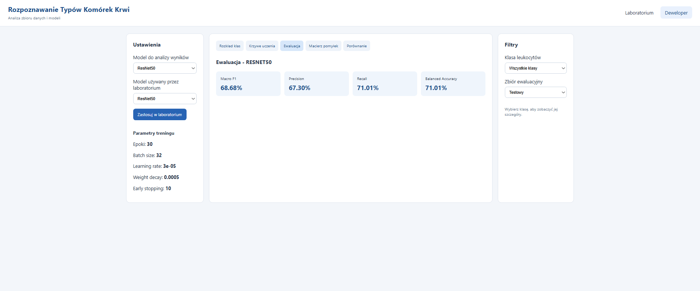
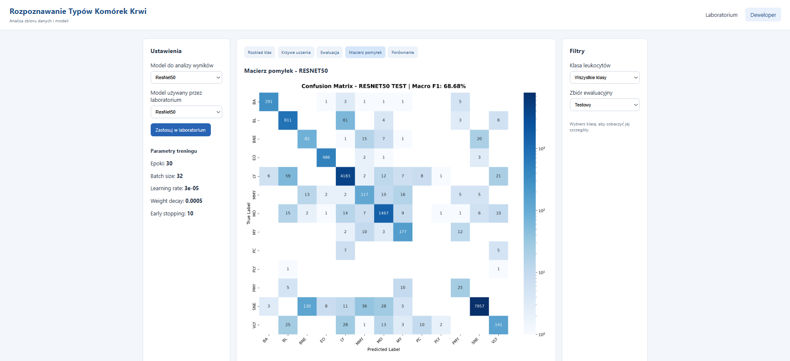
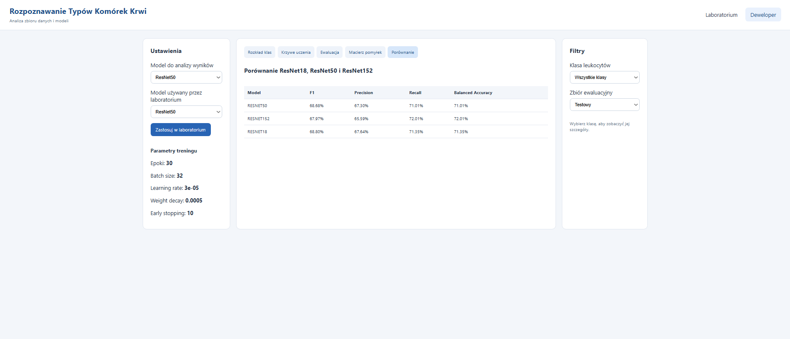
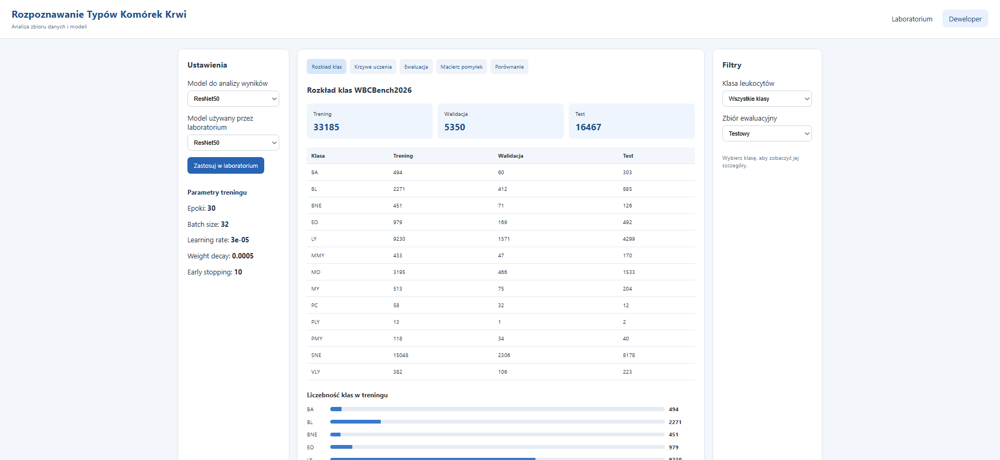

# Aplikacja wspomagająca rozpoznawanie typów komórek krwi na podstawie obrazów mikroskopowych

Projekt realizowany w ramach pracy inżynierskiej na kierunku **Inżynieria Biomedyczna** (specjalność: Informatyka w Medycynie) na Politechnice Gdańskiej.

**Autor:** Rafał Kruszewski

Aplikacja internetowa umożliwia klasyfikację obrazów białych krwinek do **13 klas** z wykorzystaniem sieci **ResNet18, ResNet50 i ResNet152**. System udostępnia dwa widoki: **Laboratorium** do analizy obrazów oraz **Deweloper** do przeglądania wyników uczenia i ewaluacji modeli.

> **Uwaga:** Projekt ma charakter badawczy i demonstracyjny. Wynik klasyfikacji nie zastępuje oceny specjalisty i nie powinien stanowić samodzielnej podstawy decyzji diagnostycznych.

---

## Interfejs aplikacji

### Laboratorium

Widok przeznaczony do analizy pojedynczych obrazów mikroskopowych. Umożliwia:

- przesłanie obrazu w formacie JPG, JPEG lub PNG oraz jego podgląd i powiększanie;
- klasyfikację obrazu aktywnym modelem ResNet;
- wyświetlenie przewidzianej klasy wraz z wynikiem procentowym, dwóch kolejnych propozycji oraz rozkładu prawdopodobieństw dla wszystkich 13 klas;
- przeglądanie historii wcześniejszych analiz;
- zapisanie ręcznej korekty etykiety w historii analizy (korekta **nie uruchamia ponownego treningu**).



### Deweloper

Widok służący do przeglądania zapisanych raportów treningu i ewaluacji. Dostępne są:

- **dwa niezależne wybory modelu**: model do analizy wyników oraz model aktywny w laboratorium;
- rozkład liczebności 13 klas w zbiorach treningowym, walidacyjnym i testowym;
- krzywe uczenia: funkcja straty i Macro F1;
- metryki ewaluacyjne: Macro F1, Precision, Recall i Balanced Accuracy;
- macierze pomyłek;
- porównanie wyników ResNet18, ResNet50 i ResNet152;
- filtrowanie wyników według klasy leukocytu oraz zbioru walidacyjnego lub testowego.









---

## Wykorzystany zbiór danych

Do trenowania i oceny modeli wykorzystano **WBCBench2026**, wariant obrazów **`pristine`**, obejmujący 55 002 obrazy białych krwinek.

| Oficjalny podzbiór | Katalog w projekcie | Liczba obrazów | Wykorzystanie |
|---|---|---:|---|
| `phase1_train` | `phase1_train/` | 8 288 | Trening |
| `phase2_train` | `phase2_train/` | 24 897 | Trening |
| `phase2_eval` | `val/` | 5 350 | Walidacja |
| `phase2_test` | `test/` | 16 467 | Test końcowy |
| **Razem** | | **55 002** | |

Podczas standardowego treningu **łączone są oba podzbiory treningowe**, czyli `phase1_train` i `phase2_train` (33 185 obrazów). Walidacja i test pozostają odrębne.

Przetwarzanie danych korzysta również z identyfikatorów `patient_hash`, aby uwzględnić liczbę obrazów należących do poszczególnych przypadków.

Rozpoznawane klasy:

`BA`, `BL`, `BNE`, `EO`, `LY`, `MMY`, `MO`, `MY`, `PC`, `PLY`, `PMY`, `SNE`, `VLY`.

**Źródło danych:** [WBCBench2026 — strona projektu](https://xudong-ma.github.io/WBCBench2026-Robust-White-Blood-Cell-Classification/)

Skrypt pobierający korzysta z repozytorium `Xin-Tian/wbcbench2026` w serwisie Hugging Face i wymaga odpowiednich uprawnień dostępu. Ze względu na rozmiar danych i warunki dostępu obrazy nie są dołączone do repozytorium projektu.

---

## Trening modeli

Proces uczenia znajduje się w notatniku `src/training.ipynb`.

Wykorzystano metodę **Transfer Learning** z wagami wstępnie wytrenowanymi na ImageNet. Ostatnią warstwę klasyfikacyjną każdej sieci dostosowano do rozpoznawania 13 klas leukocytów.

### Wykorzystane architektury

- **ResNet18**
- **ResNet50**
- **ResNet152**

### Przygotowanie danych i trening

- zmiana rozmiaru obrazów do **368 × 368 pikseli**;
- normalizacja zgodna ze statystykami ImageNet;
- augmentacja obrazów treningowych;
- optymalizator **AdamW**;
- funkcja straty **CrossEntropyLoss** z `label_smoothing=0.05`;
- **patient-aware WeightedRandomSampler** uwzględniający nierównowagę klas i liczbę obrazów pochodzących z poszczególnych przypadków;
- harmonogram zmiany współczynnika uczenia **ReduceLROnPlateau**;
- mechanizm **Early Stopping**;
- obliczenia AMP przy wykorzystaniu GPU z obsługą CUDA.

### Etapy treningu

Proces uczenia składa się z dwóch etapów:

**Etap 1 — trening całej sieci**

Trenowane są wszystkie warstwy modelu. Proces trwa maksymalnie 30 epok i może zostać zakończony wcześniej przez mechanizm Early Stopping.

**Etap 2 — dostrajanie klasyfikatora FC**

Po zakończeniu pierwszego etapu wczytywany jest najlepszy zapisany checkpoint. Pozostałe warstwy zostają zamrożone, a dalszemu uczeniu podlega jedynie końcowa warstwa `fc`.

Podczas dostrajania stosowane jest silniejsze balansowanie klas. Etap może trwać maksymalnie 10 epok, a mechanizm Early Stopping zatrzymuje go po 4 kolejnych epokach bez poprawy.

Najlepszy model wybierany jest na podstawie wartości **Macro F1 uzyskanej na zbiorze walidacyjnym**.

### Zapisywanie wyników

Każdy model ma osobny katalog w `src/reports/`.

Zapisywane są:

- najlepsze wagi modelu (`.pth`);
- parametry treningu (`training_params.json`);
- historia uczenia (`training_history.json`);
- wyniki ewaluacji walidacyjnej i testowej (`.json`);
- wykresy funkcji straty i Macro F1;
- macierze pomyłek dla zbiorów walidacyjnego i testowego.

---

## Wyniki na zbiorze testowym

Wyniki modeli klasyfikujących **13 klas leukocytów**:

| Model | Macro F1 | Macro Precision | Macro Recall | Balanced Accuracy |
|---|---:|---:|---:|---:|
| **ResNet18** | **68,80%** | **67,64%** | 71,35% | 71,35% |
| **ResNet50** | 68,68% | 67,30% | 71,01% | 71,01% |
| **ResNet152** | 67,97% | 65,59% | **72,01%** | **72,01%** |

Wszystkie trzy architektury uzyskały zbliżone wyniki ogólne. Najwyższą wartość Macro F1 osiągnął model ResNet18.

Skuteczność klasyfikacji jest jednak zróżnicowana w zależności od klasy leukocytu.

Przykładowo model ResNet50 osiągnął wysokie wartości F1 dla klas:

- **SNE:** 98,42%;
- **EO:** 98,18%;
- **LY:** 97,15%;
- **BA:** 96,52%;
- **MO:** 95,29%.

Znacznie słabsze rezultaty uzyskano dla wybranych klas, w szczególności:

- **BNE:** 46,46%;
- **PC:** 0,00%;
- **PLY:** 0,00%.

Jedną z możliwych przyczyn jest nierównomierna liczebność danych treningowych oraz niewielka liczba niezależnych przypadków reprezentujących niektóre klasy.

Uzyskane modele mają charakter eksperymentalny i nie są zwalidowane do samodzielnego zastosowania diagnostycznego.

---

## Uruchomienie projektu

### Wymagania

- Python 3.11;
- biblioteki wymienione w `requirements.txt`;
- zapisane wagi przynajmniej jednego wytrenowanego modelu.

Aplikacja może wykonywać klasyfikację na CPU lub GPU obsługującym CUDA.

### Instalacja

1. Sklonuj repozytorium:

   ```bash
   git clone <adres-repozytorium>
   ```

2. Przejdź do katalogu projektu.

3. Zainstaluj wymagane biblioteki:

   ```bash
   pip install -r requirements.txt
   ```

4. Upewnij się, że w katalogu `src/reports/` znajdują się checkpointy modeli.

   Model wskazany w `src/model_settings.json` musi posiadać odpowiedni plik wag. Domyślnie aplikacja korzysta z ResNet50.

5. Uruchom aplikację:

   ```bash
   cd src
   python app.py
   ```

6. Otwórz aplikację w przeglądarce:

   **Laboratorium:**

   http://127.0.0.1:5000/

   **Deweloper:**

   http://127.0.0.1:5000/developer

### Uruchomienie treningu

Aby ponownie przeprowadzić trening:

1. Uzyskaj dostęp do zbioru WBCBench2026.
2. Przygotuj dane
3. Otwórz notatnik `src/training.ipynb`.
4. Wybierz architekturę ResNet18, ResNet50 lub ResNet152.
5. Uruchom wszystkie komórki notatnika.

Notatnik powinien być wykonywany z katalogu `src/`, aby ścieżki danych i raportów były poprawne.

---

## Struktura projektu

```text
.
├── data/
│   └── wbcbench/
│       ├── phase1_train/              # Pierwsza faza danych treningowych
│       ├── phase2_train/              # Druga faza danych treningowych
│       ├── val/                       # Walidacja (phase2_eval)
│       ├── test/                      # Test końcowy (phase2_test)
│       ├── dataset_info.json         # Informacje o zbiorze i liczebnościach klas
│       └── image_metadata.csv        # Metadane obrazów, w tym patient_hash
│
├── src/
│   ├── app.py                        # Serwer Flask i obsługa klasyfikacji
│   │
│   ├── training.ipynb                # Trening i ewaluacja modeli
│   ├── history.json                  # Historia przeprowadzonych analiz
│   ├── model_settings.json           # Ustawienia aktywnego modelu
│   │
│   ├── reports/
│   │   ├── resnet18/                 # Raporty i checkpoint ResNet18
│   │   ├── resnet50/                 # Raporty i checkpoint ResNet50
│   │   └── resnet152/                # Raporty i checkpoint ResNet152
│   │
│   ├── static/
│   │   ├── uploads/                  # Obrazy przesłane przez użytkownika
│   │   ├── style.css                 # Style interfejsu
│   │   └── script.js                 # Obsługa interfejsu w JavaScript
│   │
│   └── templates/
│       ├── laboratory.html           # Panel laboratorium
│       └── developer.html            # Panel dewelopera
│
├── screenshots/
│   ├── interfejs_laboratorium_wynik.png
│   ├── interfejs_laboratorium_historia.png
│   ├── interfejs_deweloper_ewaluacja.png
│   ├── interfejs_deweloper_macierz_pomylek.png
│   ├── interfejs_deweloper_porownanie.png
│   └── interfejs_deweloper_rozklad_klas.png
│
├── thesis/                            # Materiały pracy inżynierskiej
├── README.md                          # Dokumentacja projektu
└── requirements.txt                   # Wymagane biblioteki
```

### Przykładowa zawartość folderu raportów

```text
src/reports/resnet50/
├── best_resnet50_wbc.pth
├── training_params.json
├── training_history.json
├── validation_metrics.json
├── test_metrics.json
├── loss.png
├── f1.png
├── confusion_matrix_validation.png
└── confusion_matrix_test.png
```

---

## Wykorzystane technologie

| Obszar | Technologie |
|---|---|
| Język programowania | Python 3.11 |
| Backend | Flask, Jinja2 |
| Deep Learning | PyTorch, Torchvision |
| Architektury sieci | ResNet18, ResNet50, ResNet152 |
| Przetwarzanie obrazów | Pillow, torchvision.transforms |
| Analiza danych | NumPy, scikit-learn |
| Wizualizacja | Matplotlib, Seaborn |
| Frontend | HTML5, CSS3, JavaScript |
| Środowisko eksperymentalne | Jupyter Notebook |
| Przyspieszenie obliczeń | NVIDIA CUDA, AMP |
| Kontrola wersji | Git |

---
