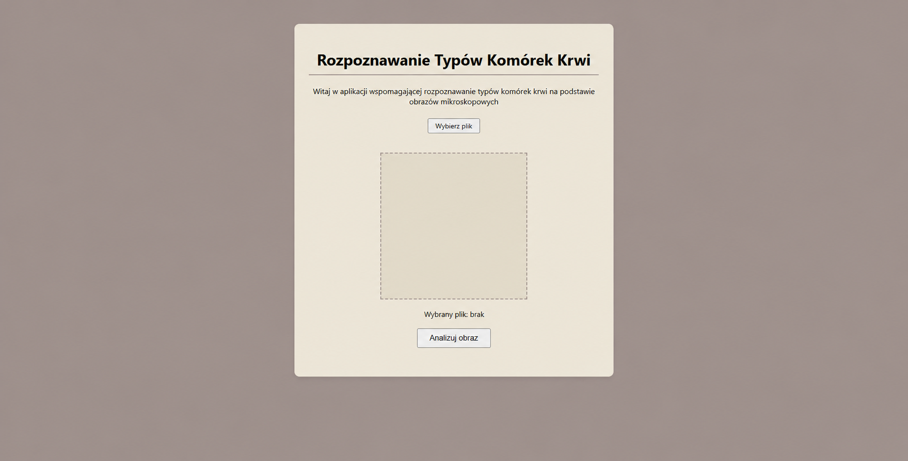
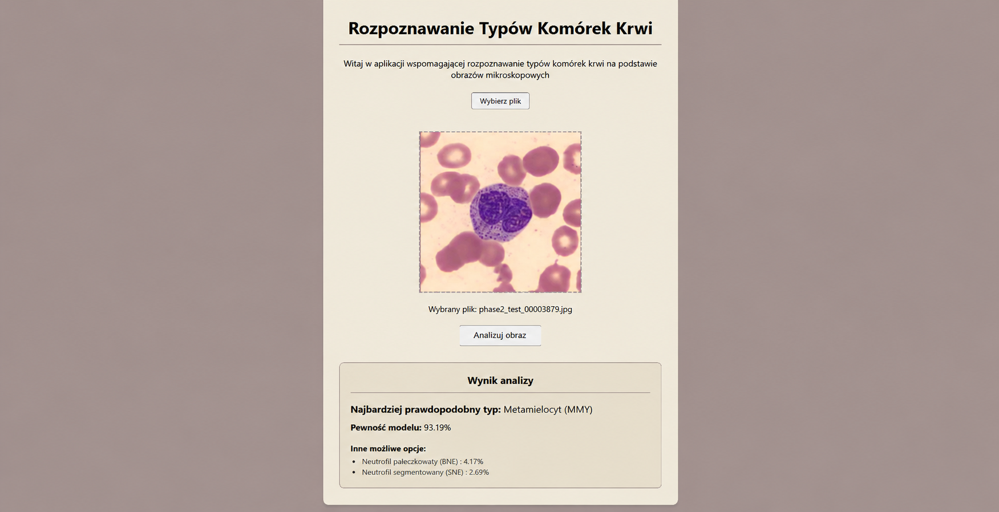

# Aplikacja wspomagająca rozpoznawanie typów komórek krwi na podstawie obrazów mikroskopowych

Projekt realizowany w ramach pracy inżynierskiej. Aplikacja internetowa stanowi narzędzie wspomagające diagnostykę medyczną, umożliwiając zautomatyzowaną klasyfikację białych krwinek (13 klas) z wykorzystaniem głębokich sieci neuronowych (ResNet50).

- **Autor:** Rafał Kruszewski
- **Nr indeksu:** 198259
- **Uczelnia:** Politechnika Gdańska
- **Kierunek:** Inżynieria Biomedyczna
- **Specjalność:** Informatyka w Medycynie

---

## Obecny stan projektu

Obecnie aplikacja posiada w pełni działający interfejs użytkownika (GUI) zaimplementowany przy użyciu frameworka Flask oraz zintegrowany backend z wytrenowanym modelem **ResNet50** w bibliotece PyTorch. Poniżej znajdują się zrzuty ekranu prezentujące wygląd aplikacji:

### Aktualny widok aplikacji z predykcją modelu:




### Zrealizowane funkcjonalności:
- **Przesyłanie plików:** Możliwość wyboru pliku ze zdjęciem mikroskopowym z dysku lokalnego (przycisk *Wybierz plik*).
- **Podgląd na żywo:** Załadowane zdjęcie jest natychmiast wyświetlane w panelu podglądu wraz z nazwą wybranego pliku.
- **Automatyczne przetwarzanie wstępne (Preprocessing):** Przesłany obraz jest automatycznie konwertowany do formatu RGB, skalowany do wymiarów `368x368` pikseli oraz normalizowany zgodnie ze statystykami zbioru ImageNet przed podaniem na wejście sieci.
- **Klasyfikacja AI (ResNet50):** Po kliknięciu przycisku *Analizuj obraz* wytrenowany model klasyfikuje komórkę do jednej z 13 klas leukocytów (`BA`, `BL`, `BNE`, `EO`, `LY`, `MMY`, `MO`, `MY`, `PC`, `PLY`, `PMY`, `SNE`, `VLY`).
- **Sekcja wyników (Top-3):** Aplikacja zwraca najbardziej prawdopodobny typ komórki (wraz z polską nazwą i pewnością procentową oraz wyświetla 2 kolejne najbardziej prawdopodobne alternatywy.

---

## Trening modelu i eksperymenty

W procesie uczenia wykorzystano technikę **Transfer Learningu** na bazie architektury **ResNet50** (wstępnie wytrenowanej na zbiorze ImageNet):
- **Kompensacja niezbalansowania klas:** Zastosowano ważoną funkcję straty `CrossEntropyLoss` z wagami klas wygładzonymi pierwiastkiem kwadratowym oraz augmentację danych treningowych (losowe odbicia, rotacje, `ColorJitter`).
- **Optymalizacja:** Wykorzystano optymalizator `AdamW` (`lr=0.0001`, `weight_decay=1e-4`), harmonogram wygaszania współczynnika uczenia `CosineAnnealingLR` oraz mechanizm *Early Stopping* (`patience=12`).
- **Wyniki:** Model osiągnął wynik **Macro F1 = 79.58%** na zbiorze walidacyjnym oraz **Macro F1 = 76.98%** na zbiorze testowym.

---

## Baza danych (WBCBench 2026)

Do treningu i ewaluacji modelu wykorzystano zbiór danych pochodzący z konkursu **WBCBench 2026: Robust White Blood Cell Classification Under Class Imbalance and Domain Shift** (organizowanego w ramach konferencji *IEEE ISBI 2026*). Zbiór obejmuje łącznie 55 002 obrazy podzielone na zbiór treningowy (38 495), walidacyjny (8 245) oraz testowy (8 262).

- **Strona projektu i informacje o zbiorze:** [WBCBench 2026 Official Page](https://xudong-ma.github.io/WBCBench2026-Robust-White-Blood-Cell-Classification/)
- **Dostępność:** Baza danych ma charakter **zamknięty** (nie jest publicznie otwarta do bezpośredniego pobrania). Aby uzyskać dostęp do obrazów i móc je pobrać (np. za pomocą przygotowanego skryptu `dataset_download.py`), konieczne jest wcześniejsze zgłoszenie się do organizatorów wyzwania i otrzymanie indywidualnego zaproszenia/autoryzacji. Ze względu na restrykcje licencyjne oraz rozmiar plików, folder `data/` nie jest dołączony do publicznego repozytorium.

---

## Technologie

W projekcie wykorzystano następujące technnologie i narzędzia:

- **Język programowania i backend:** Python 3.11, Flask, Jinja2
- **Deep Learning i uczenie maszynowe:** PyTorch, Torchvision, ResNet50, Transfer Learning
- **Przetwarzanie obrazów:** Pillow (PIL), torchvision.transforms
- **Przygotowanie danych i trenowanie modelu:** torch.utils.data, DataLoader, ImageFolder, torch.nn, torch.optim
- **Optymalizacja procesu uczenia:** AdamW, CosineAnnealingLR, Early Stopping, CrossEntropyLoss
- **Analiza danych i obliczenia numeryczne:** NumPy, Scikit-learn (sklearn), collections.Counter
- **Ewaluacja modelu:** Precision, Recall, F1-score, Macro F1, Balanced Accuracy, Confusion Matrix
- **Wizualizacja danych i wyników:** Matplotlib, Seaborn
- **Frontend:** HTML5, CSS3, JavaScript (Vanilla JS), FileReader API
- **Obsługa plików i środowisko uruchomieniowe:** Flask, Jinja2, NVIDIA CUDA (opcjonalnie), CPU
- **Narzędzia programistyczne:** Jupyter Notebook, tqdm, Git

---

## Struktura projektu

```text
├── data/
│   └── wbcbench/                                # Zamknięty zbiór danych WBCBench 2026 (pomijany w repozytorium)
│       ├── test/                                # Zbiór testowy (8 262 obrazy)
│       ├── train/                               # Zbiór treningowy (38 495 obrazów)
│       └── val/                                 # Zbiór walidacyjny (8 245 obrazów)
├── src/                                         
│   ├── static/                               
│   │   ├── uploads/                             # Folder na przesłane przez użytkownika zdjęcia
│   │   ├── script.js                            # Logika podglądu zdjęć w JavaScript
│   │   └── style.css                            # Style wizualne CSS
│   ├── templates/                               
│   │   └── index.html                           # Główny interfejs użytkownika w HTML
│   ├── .gitattributes                           # Konfiguracja statystyk języków dla platformy GitHub
│   ├── app.py                                   # Główny plik serwera (Flask) z obsługą modelu ResNet50
│   ├── best_resnet50_wbc.pth                    # Zapisane wagi wytrenowanego modelu ResNet50
│   ├── confusion_matrix_resnet50_test.png       # Macierz pomyłek dla zbioru testowego
│   ├── confusion_matrix_resnet50_validation.png # Macierz pomyłek dla zbioru walidacyjnego
│   └── training.ipynb                           # Notatnik Jupyter z procesem trenowania i ewaluacją
├── thesis/                                      
│   └── INŻYNIERKA (20).pdf                      # Aktualna wersja inżynierki
├── interfejs_aplikacja.png                      # Zrzut ekranu działającej aplikacji
├── interfejs_aplikacja_wynik.png                # Zrzut ekranu działającej aplikacji z wynikiem analizy
├── README.md                                    # Dokumentacja projektu
└── requirements.txt                             # Lista wymaganych bibliotek języka Python